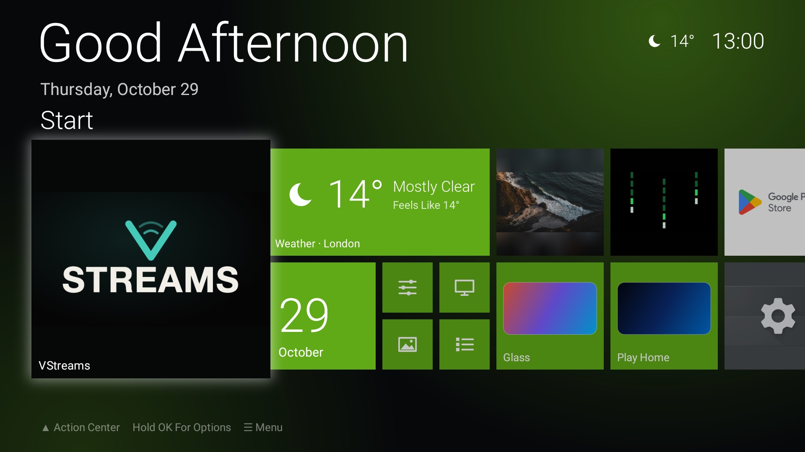
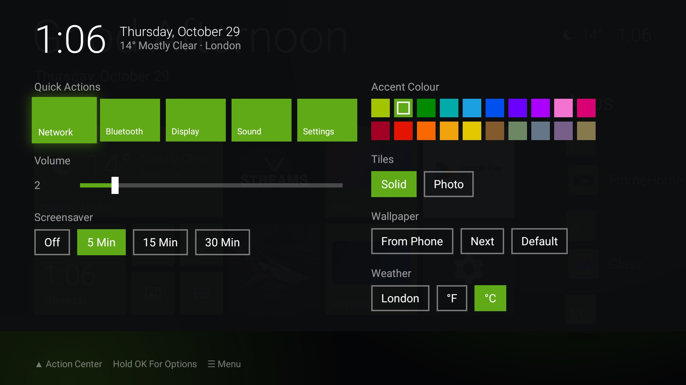
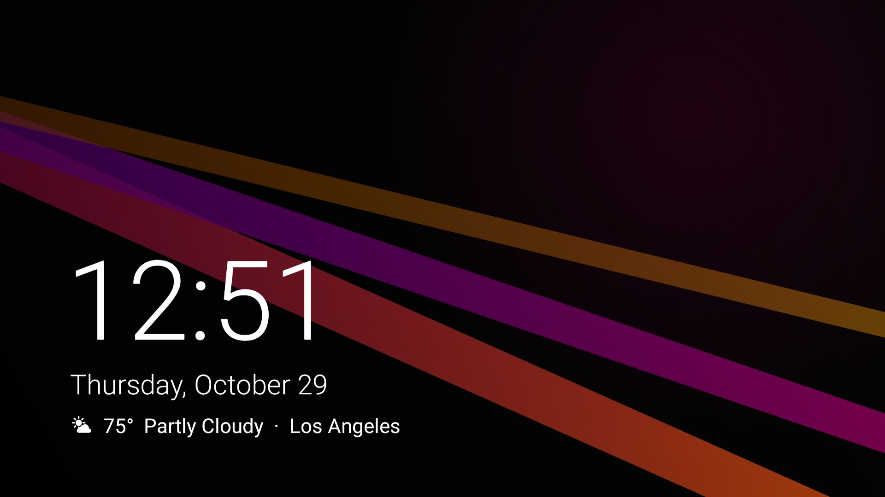
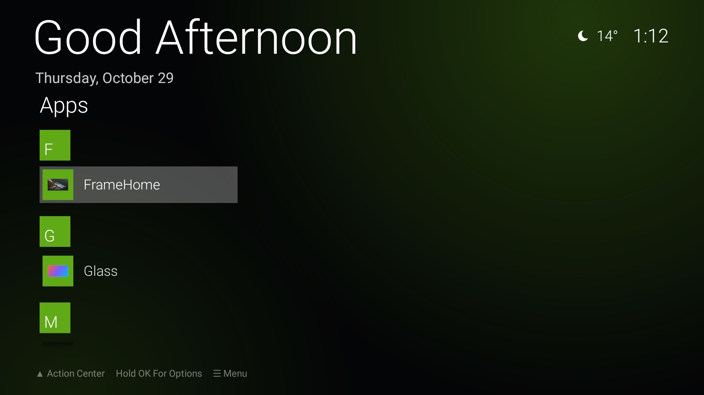

# Arcade

A free, ad-free home screen for Android TV and Google TV, inspired by Windows Phone's Start screen:
live tiles, a hero tile for your favourite app, and a pull-down Action Center.



- **Live tiles**: weather (now, then the next three days) and a clock that turn over every few seconds.
- **Your favourites first**: Start fills itself with the apps you open most, then popular streaming
  apps. Hold OK on any tile to resize it, recolour it, move it, pin it or make it the hero.
- **Action Center**: pull it down for quick settings, volume, HDMI inputs, accent colours, tile
  style, wallpaper, weather and the screensaver.
- **Wallpapers from your phone**: scan a QR code and send photos straight to the TV.
- **Lock-screen screensaver**: your wallpaper, a big clock, the date and the weather.
- **Nothing extra**: no ads, no accounts, no tracking. One small library (ZXing, for the QR code).

Works on Android TV / Google TV 9 and up: Chromecast with Google TV, Google TV Streamer, Onn,
Shield, and TVs with Google TV built in. On Fire TV it runs as an app but can't replace the home
screen.

| Action Center | Lock screen | Apps |
|---|---|---|
|  |  |  |

## Install

You need a computer with [`adb`](https://developer.android.com/tools/releases/platform-tools)
and **Developer options → USB / network debugging** turned on on the TV.

```bash
adb connect <tv-ip>:5555
curl -LO https://github.com/MattDillionCodes/arcade-tv/releases/latest/download/arcade-tv.apk
adb install arcade-tv.apk
adb shell cmd package set-home-activity io.github.mattdillioncodes.arcade/com.matthew.arcade.HomeActivity
adb shell input keyevent KEYCODE_HOME
```

Each release also has `arcade-tv.apk.sha256` so you can check the download:
`shasum -a 256 -c arcade-tv.apk.sha256`.

### Undo

```bash
adb uninstall io.github.mattdillioncodes.arcade
```

The TV goes back to its own home screen. (If it ever shows a blank screen instead, run
`adb shell cmd package set-home-activity` with your TV's original launcher.)

## Using it

| Button | Does |
|---|---|
| Up from the top row, Menu, gamepad Y | Action Center |
| Hold OK, gamepad X | Options for the focused app: size, make hero, colour, move, pin/unpin |
| Back | Close whatever is open, or return to the hero tile |
| Home | Back to the hero tile |

- **Weather**: press the weather tile and type your city. Nothing is fetched until you choose
  one, and Arcade never looks up your location. °F or °C follows your country; change it in
  Action Center.
- **Wallpaper from your phone**: the picture tile (or Action Center → From Phone) shows a QR code.
  Your phone and TV must be on the same network. The phone crops each photo to 1920×1080 before
  sending it. The upload page only exists while that screen is open, and every QR code has a new
  random address.
- **Screensaver**: starts after 5 idle minutes (15, 30 or off in Action Center). Any button
  wakes it, and that press does nothing else.

## Privacy

Arcade only goes online for two things, both to [Open-Meteo](https://open-meteo.com) (free, no
account): searching for the city you type, and fetching that city's forecast. It sends nothing
about you or your TV. The wallpaper upload server is local to your home network and only runs
while its screen is open.

## Building

Kotlin, plain Android Views, no Compose. Needs JDK 17+ (Android Studio's bundled one is fine).

```bash
./gradlew assembleRelease                   # app/build/outputs/apk/release/app-release.apk
./install.sh                                # build, install on the connected device, set as Home
TV=192.168.1.50:5555 ./install.sh           # same, for a TV over network ADB
```

Local builds are signed with the debug key. Releases are built and signed by GitHub Actions when
a `v*` tag is pushed (see [.github/workflows/release.yml](.github/workflows/release.yml)).

On the emulator a phone can't reach the upload server; forward the port and use your computer's
browser instead (the QR screen shows the URL): `adb forward tcp:8765 tcp:8765`.

## Credits

Weather data by [Open-Meteo.com](https://open-meteo.com) (CC BY 4.0). QR codes by
[ZXing](https://github.com/zxing/zxing) (Apache 2.0). See [THIRD_PARTY_NOTICES.md](THIRD_PARTY_NOTICES.md).

Arcade is an independent project. It is not affiliated with or endorsed by Microsoft, Google, or
any TV maker. Windows Phone is a trademark of Microsoft; it's named here only to describe the
design inspiration. App names and logos shown on tiles belong to their owners.

## License

[MIT](LICENSE)
